<div align="center">


<br/>

[](https://www.loom.com/share/99f373cda7444448bf81cfa00831a2c6)
[](docs/TEST_EVIDENCE.md)
[](workflows/)
[](sql/)


**Lesson 12 assessment: Outbound Calling, Compliance-Aware Follow-Up and Batch Campaigns**

[Overview](#-overview) |
[Architecture](#-architecture) |
[Evidence](#-evidence-gallery) |
[Honest status](#-what-was-and-was-not-tested) |
[Repo map](#-repository-map) |
[Setup](#-setup)

</div>

---

## 🎯 Overview

A compliance-first outbound campaign: leads come from Supabase, every lead passes a **timezone window guard** and a **DNC check** before a call request is built, a **safety gate** keeps real dialing off by default, requests are **throttled to 5 per second**, a verbal opt-out writes straight to the DNC registry, and every finished call is **logged by a signature-verified webhook**.

| | Feature | How it works |
|---|---|---|
| 🕗 | **Calling window guard** | Local time per lead timezone, allowed 08:00 to 21:00, otherwise `skipped_outside_call_window` |
| 🚫 | **DNC suppression** | `dnc_status = TRUE` leads are never dialed; unknown status is skipped too |
| 🧩 | **Dynamic variables** | `first_name`, `product_name`, `campaign_id` sent in `retell_llm_dynamic_variables` |
| 🔒 | **Safety gate** | `call_gate = BLOCKED` by default; missing from-number stops the run before any API call |
| ⚡ | **Throttle** | HTTP batching: 5 requests per 1000 ms |
| 🗣️ | **Verbal opt-out** | Retell tool `register_dnc_optout` calls an n8n webhook (header auth, parameterized SQL) |
| 🧾 | **Webhook logging** | HMAC-SHA256 signature check, invalid means `401` and nothing written, valid means a row in `campaign_call_logs` |

---

## 🧭 Architecture

<div align="center">

</div>

```text
n8n Dispatcher (manual trigger)
  Campaign Config -> Read Leads -> Evaluate Compliance (DNC, protected numbers, 08:00-21:00 local)
    -> Is Eligible? -> Prepare Retell Request -> Safety Gate -> Required Config check
    -> POST https://api.retellai.com/v2/create-phone-call   (batches of 5, 1000 ms apart)
    -> Update last_call_attempt   (only after Retell accepts the call)

During a call:   opt-out heard -> register_dnc_optout -> n8n DNC webhook -> dnc_status = TRUE
After a call:    Retell webhook -> verify x-retell-signature -> map outcome -> INSERT campaign_call_logs
```

---

## 🖼️ Evidence gallery

> All screenshots are real executions on mock data. Phone numbers are masked. Outputs that have no screenshot (night-time block, throttle run) are transcribed in [docs/TEST_EVIDENCE.md](docs/TEST_EVIDENCE.md).

### 1. Data and dispatcher

<table>
<tr>
<td width="50%">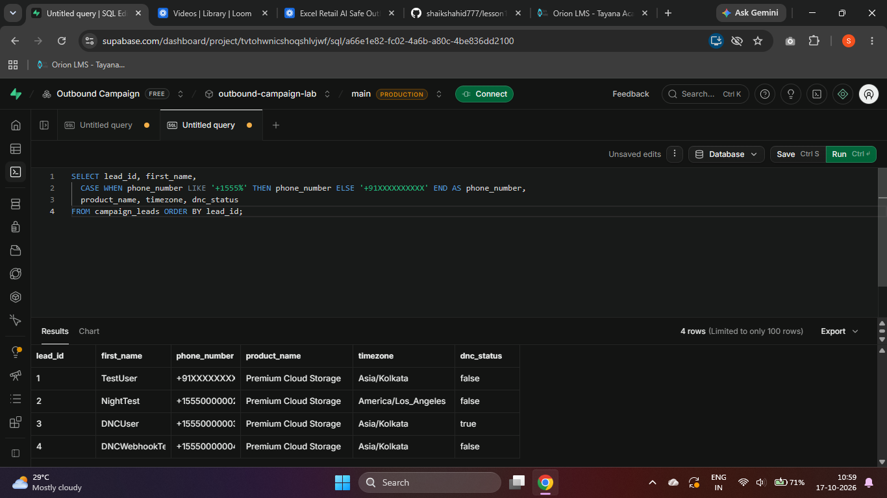<br/><sub><b>01</b> Test leads in Supabase</sub></td>
<td width="50%">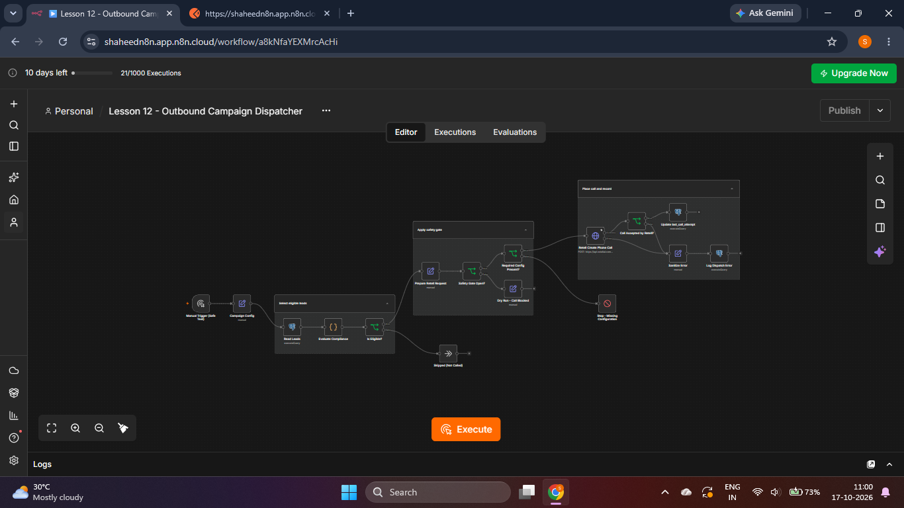<br/><sub><b>02</b> Dispatcher workflow, full canvas</sub></td>
</tr>
<tr>
<td width="50%">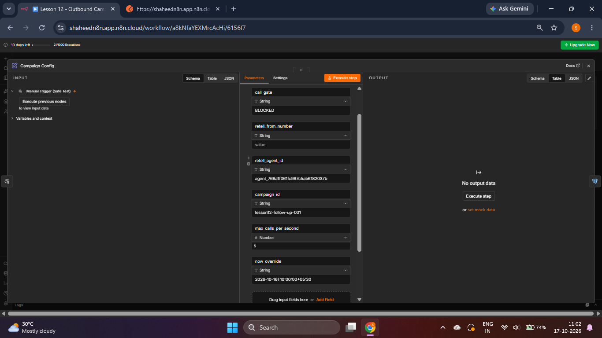<br/><sub><b>03</b> Config: <code>call_gate = BLOCKED</code>, 5 calls per second</sub></td>
<td width="50%">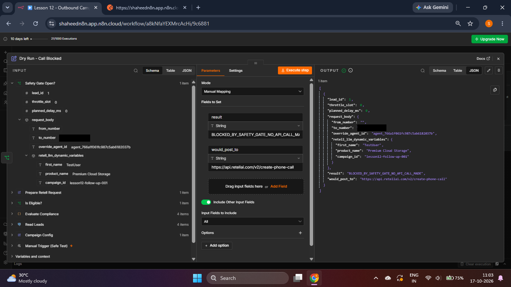<br/><sub><b>04</b> Dry run: request prepared, <code>NO_API_CALL_MADE</code></sub></td>
</tr>
</table>

### 2. DNC opt-out

<table>
<tr>
<td width="50%">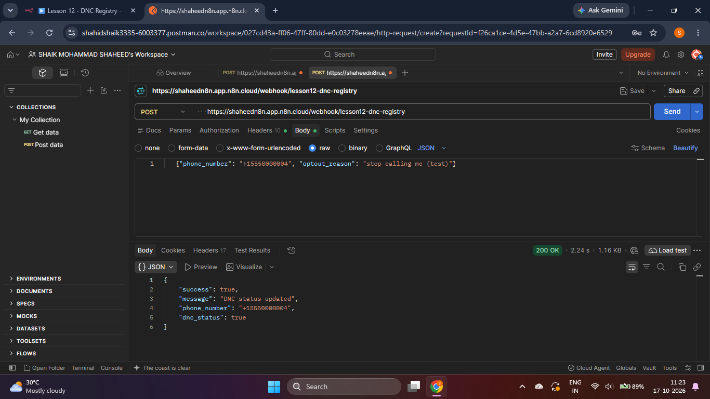<br/><sub><b>05</b> DNC webhook returns <code>200</code>, <code>dnc_status: true</code></sub></td>
<td width="50%">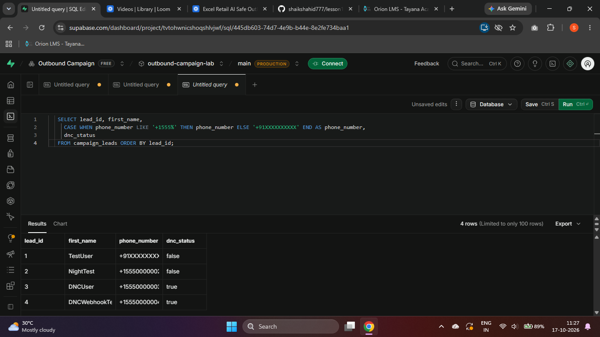<br/><sub><b>06</b> Database updated: lead 4 is <code>true</code></sub></td>
</tr>
</table>

### 3. Post-call webhook: valid signature

<table>
<tr>
<td width="50%">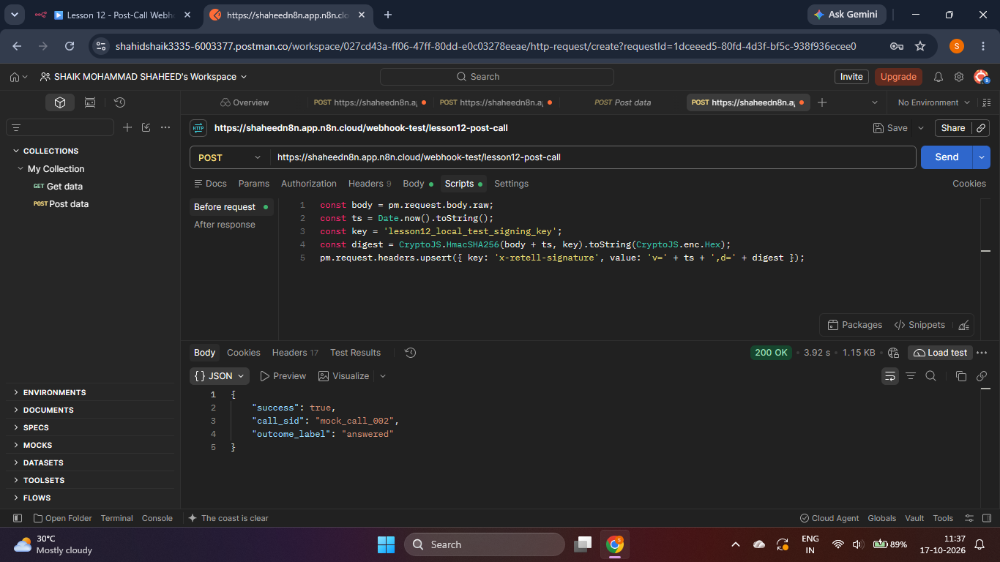<br/><sub><b>07</b> Signed mock payload returns <code>200</code>, <code>answered</code></sub></td>
<td width="50%">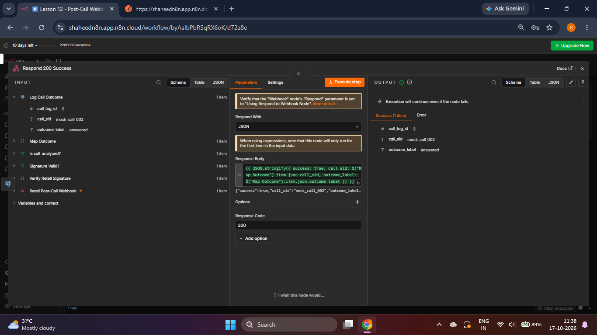<br/><sub><b>08</b> n8n node output with <code>call_log_id</code></sub></td>
</tr>
<tr>
<td width="50%">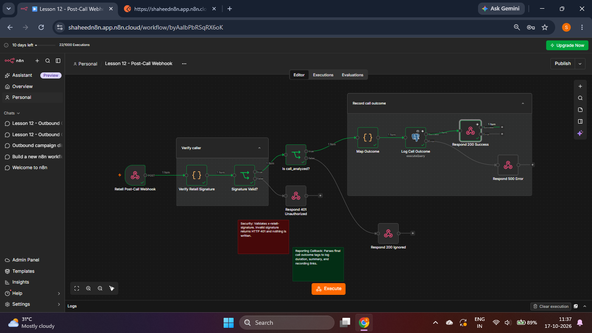<br/><sub><b>09</b> Valid path executed end to end</sub></td>
<td width="50%">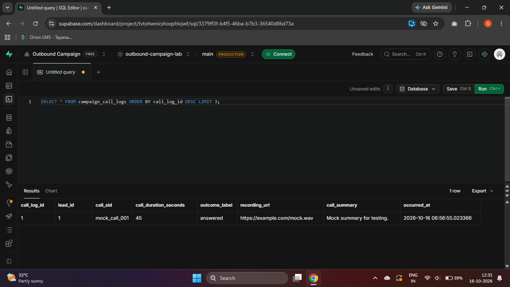<br/><sub><b>10</b> Row written to <code>campaign_call_logs</code></sub></td>
</tr>
</table>

### 4. Post-call webhook: invalid signature

<table>
<tr>
<td width="33%">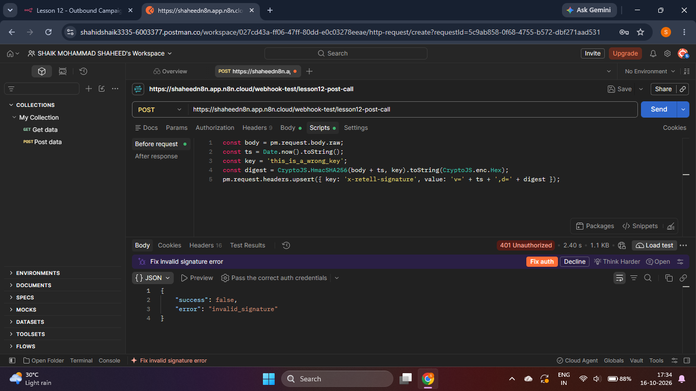<br/><sub><b>11</b> Wrong key returns <code>401 invalid_signature</code></sub></td>
<td width="33%">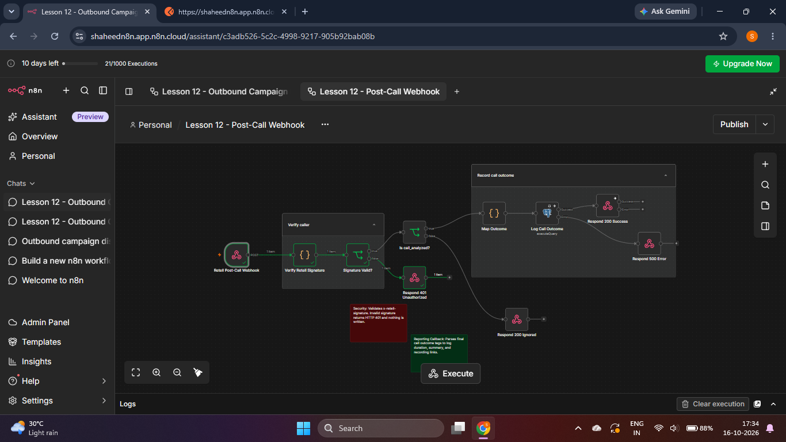<br/><sub><b>12</b> The 401 branch ran, nothing else did</sub></td>
<td width="33%">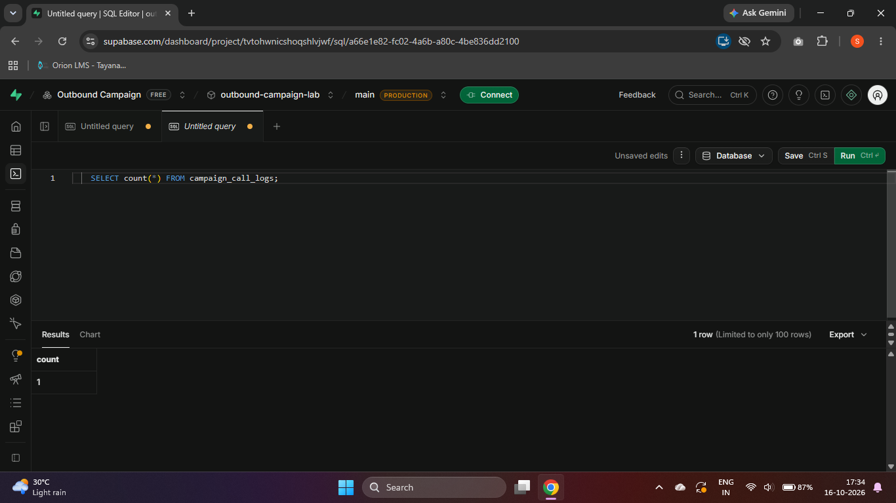<br/><sub><b>13</b> Log row count unchanged after the request</sub></td>
</tr>
</table>

---

## ✅ What was and was not tested

<table>
<tr>
<th>Verified by real execution (mock data)</th>
<th>Configured, not tested live</th>
</tr>
<tr>
<td valign="top">

- Calling-window block at 23:30 IST
- DNC suppression in the dispatcher
- DNC webhook updates the database
- Signed webhook logs a call outcome
- Invalid signature returns `401`, nothing written
- Throttle: 5, 5, 5 requests per second (mock endpoint)
- Dispatcher dry run with the gate `BLOCKED`

</td>
<td valign="top">

- Agent speaking the dynamic greeting on a real call
- Retell tool invoking the n8n DNC webhook during a real call
- Retell accepting `/v2/create-phone-call`
- A real Retell post-call webhook (tested with a signed mock payload)

</td>
</tr>
</table>

To conserve Retell credits and avoid unsolicited calls, **no real outbound call was placed and no Retell phone number was purchased.** The throttle test proves the batching settings against a mock endpoint, not against Retell.

| Test | Result |
|---|---|
| TC-002 calling window | ✅ Pass |
| DNC suppression and DNC webhook | ✅ Pass |
| TC-004 call logging (mock payload) | ✅ Pass |
| Invalid signature returns 401 | ✅ Pass |
| TC-005 throttle (mock endpoint) | ✅ Pass |
| TC-001 greeting and TC-003 tool call on a live call | ⏸️ Not run |

Full outputs: [docs/TEST_EVIDENCE.md](docs/TEST_EVIDENCE.md).

---

## 🗂️ Repository map

```text
.
├── assets/                 banner and flow diagram (animated SVG)
├── docs/
│   ├── TEST_EVIDENCE.md    test table with transcribed outputs
│   └── screenshots/        13 real screenshots, numbers masked
├── postman/                signed mock webhook request and pre-request script
├── prompts/                outbound agent prompt
├── retell/                 register_dnc_optout tool definition (secret omitted)
├── sql/                    schema.sql, seed_test_leads.sql
└── workflows/
    ├── lesson12-outbound-campaign-dispatcher.json
    ├── lesson12-dnc-registry.json
    ├── lesson12-post-call-webhook.json
    └── lesson12-throttle-test-mock.json
```

---

## 🛠️ Setup

<details>
<summary><b>Click to expand the 5 setup steps</b></summary>

1. Create the tables with `sql/schema.sql`, then seed with `sql/seed_test_leads.sql` (replace the placeholder phone number with your own test number).
2. Import the four workflows into n8n and attach your own Postgres credential.
3. **DNC workflow:** create an n8n Header Auth credential (header `X-DNC-Secret`) and use the same secret in the Retell tool. Never commit the secret.
4. **Post-call workflow:** set the n8n variable `RETELL_API_KEY` (Retell signs webhooks with the API key). This repo contains no keys.
5. **Dispatcher:** in `Campaign Config` set `retell_from_number` (a Retell number you own) and switch `call_gate` from `BLOCKED` to `ENABLED` only when you intend to place real calls. `now_override` is for dry runs; clear it for real runs.

</details>

<details>
<summary><b>Run the webhook tests yourself (no Retell credits)</b></summary>

1. In n8n open the post-call workflow, click the Webhook node, then **Listen for test event**.
2. In Postman create a `POST` to the test URL with the body from `postman/mock_post_call_body.json`.
3. Paste `postman/signed_request_prescript.js` into **Scripts, Pre-request** and send. Expect `200` and `outcome_label: answered`.
4. Change `key` in the script to any wrong value and send again. Expect `401 invalid_signature` and no new row.

</details>

---

## 🛡️ Safety design

- The gate is `BLOCKED` by default; a missing from-number stops the run before any API request.
- Fictional numbers `+15550000002`, `+15550000003`, `+15550000004` are never dialed.
- DNC leads, unknown DNC status, and missing or invalid timezones are skipped.
- Secrets live in n8n credentials and variables, never in this repository.
- Webhook responses never echo secrets, and invalid signatures write nothing.

<div align="center">
<sub>Built for the Lesson 12 assessment | Retell AI + n8n + Supabase</sub>
</div>
