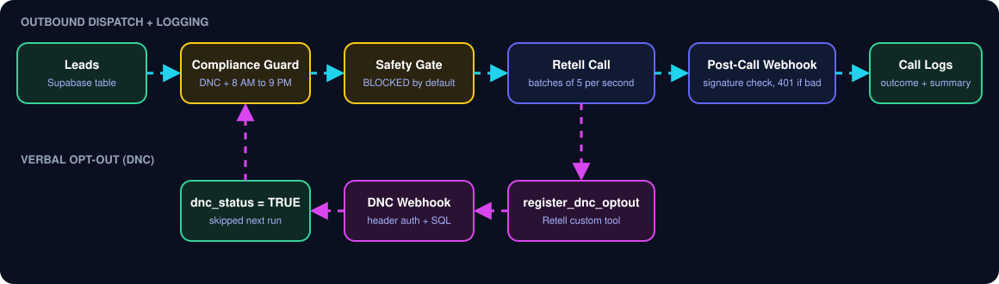

# Lesson 12 — Outbound Calling & Compliance-Aware Campaigns

<b>Retell AI · n8n · Supabase/PostgreSQL</b> Batch dispatch · Dynamic variables · Local-time safeguards · DNC suppression · Signed webhook logging

<a href="#architecture">Architecture</a> · <a href="#setup">Setup</a> · <a href="#validation-evidence">Validation</a> · <a href="#demo">Demo</a>

> **Assessment/lab project.** Do not use for live campaigns until credentials, provider settings, applicable legal requirements, and end-to-end tests have been independently verified.

## Overview

This project demonstrates a compliance-aware outbound follow-up design using Retell AI, n8n, and Supabase/PostgreSQL. It covers per-lead dynamic variables, local-time dialing-window checks, do-not-call (DNC) suppression, throttled dispatch, and signed post-call webhook logging.

## Architecture

1. Load campaign leads from the database.
2. Evaluate eligibility: DNC status, required lead data, test/protected numbers, and the lead's local dialing window.
3. Prepare a Retell request with first_name, product_name, and campaign identifiers.
4. Apply safety/configuration gates before sending an outbound API request.
5. Throttle dispatch and record outcomes for auditing.
6. Receive post-call events through a signature-verified n8n webhook.
7. Store valid call logs in campaign_call_logs; reject invalid signatures without inserting a row.
8. Register opt-outs and suppress future calls to that lead.

## Repository map

| Path | Purpose |
|---|---|
| assets/banner.svg | Animated project banner |
| assets/flow.svg | Architecture diagram |
| sql/schema.sql | PostgreSQL/Supabase schema |
| sql/seed_test_leads.sql | Synthetic test leads |
| prompts/outbound_agent_prompt.md | Agent prompt and opt-out behavior |
| retell/register_dnc_optout.tool.json | DNC tool configuration reference |
| workflows/ | n8n workflow exports |
| postman/ | Mock payload and signing helper |
| docs/TEST_EVIDENCE.md | Evidence index and test-status boundaries |
| docs/screenshots/ | Genuine assessment screenshots, when included |

## Compliance and safety controls

- **Local time:** this lab's target dialing window is 08:00–21:00 in the lead's timezone. Verify applicable laws and stricter local rules before any production use.
- **DNC:** the agent should stop politely and register opt-out. If persistence fails, fail closed and do not continue calling that lead.
- **Dynamic variables:** pass only the lead-specific values required by the agent.
- **Credentials:** keep API keys, webhook secrets, and database credentials in n8n credentials/environment settings. Never commit secrets.
- **Rate control:** respect provider limits and use a conservative batch size/delay.
- **Test data:** use synthetic leads and mock calls in demos. Do not call real people without valid authorization and consent.

## Setup

1. Create a Supabase project and run sql/schema.sql in the SQL Editor.
2. Insert synthetic leads using sql/seed_test_leads.sql; adapt values for your environment.
3. Import workflow JSON files from workflows/ into n8n.
4. Configure Supabase/Postgres and Retell credentials in n8n. Keep secrets out of exported JSON.
5. Configure the Retell outbound agent with first_name and product_name dynamic variables and the DNC tool.
6. Set the DNC webhook URL and authentication to match your n8n workflow.
7. Configure the post-call webhook and shared signing secret on both sender and receiver.
8. Test mock payloads first. Verify allowed/blocked paths, database writes, invalid signatures, and DNC suppression before live use.

Exact node names, credential names, webhook paths, and provider settings may need adjustment to match your workspace.

## Validation evidence

The supplied working notes report a mock post-call request returning HTTP 200, an n8n response containing call_log_id: 2, and a valid workflow path. The notes also describe two mock call-log rows. Nighttime blocking, invalid-signature rejection, unchanged row count, and throttle validation were listed as remaining checks.

Only mark a test as passed after confirming its actual workspace result and retaining genuine evidence. See [docs/TEST_EVIDENCE.md](docs/TEST_EVIDENCE.md).

## Demo

- [Topic 12 overview video](https://youtu.be/VprLAko2h4Q)
- [Lesson 12 assessment reference](https://youtu.be/37Cghh3qd0c)

Suggested short demo: show the agent prompt and variables, a nighttime block, DNC registration, a valid signed mock webhook and its database row, then an invalid-signature rejection without a new row.

## Test status from supplied notes

| Area | Status |
|---|---|
| Mock post-call webhook success | Reported as tested; retain matching evidence |
| n8n response with log ID | Reported as tested; retain matching evidence |
| Nighttime timezone block | Pending confirmation |
| Invalid signature → 401 | Pending confirmation unless actually run |
| Row count unchanged after invalid request | Pending confirmation |
| 5/5/5 throttle test | Pending confirmation |
| Full live outbound campaign | Not claimed as tested |

## Security note

Before submission, inspect workflow exports and screenshots for API keys, webhook secrets, authorization headers, phone numbers, email addresses, and personal data. Rotate any secret that may have been exposed.

## License

Educational assessment project. Add a license only if you intend to grant reuse permissions.
